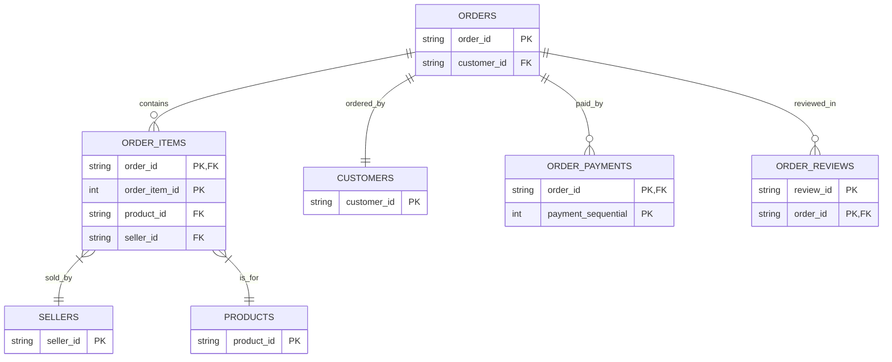

# Methodology

## 1. Extract and Preview Data

- Kaggle's API was used to extract a total of 8 datasets used in this analysis.

- Previews of all datasets can be found at [Raw Data Previews](outputs/raw_data_previews.md).

- See [data extraction](scripts/01.extract_and_preview_data.py) for code.

## 2. Exploratory Data Analysis

- To ensure that the underlying data was fit for purpose and sound, exploratory analysis was performed using the Pandas library in Python. The following operations were performed to evaluate the data:

    - Calculated number of rows for each dataset
    - Calculated number of missing values for each column of each dataset
    - Created a time series of order by month
    - Calculated the number of duplicate rows for each dataset
    - Constructed a histogram of sale prices of items
    - Constructed a summary of sale price data (minimum, maximum, median, and mean)

- See [exploratory data analysis](scripts/02.exploratory_data_analysis.py) for code.

## 3. Investigation of Keys

- Each column in each dataset was tested for whether it uniquely identifies every row, using the [key checks script](scripts/03.check_keys.py). A column is a primary key candidate if all of its values are distinct. The usual requirement that a primary key has no missing values was not tested on account of our exploratory data analysis indicating no missing values in ID columns.

- Some datasets have more than one primary key candidate. In the orders dataset for example, both order_id and customer_id are unique but order_id is treated as the primary key. These primary key candidates are listed in Table 1 of the [key investigation results](outputs/key_investigation_results.md).

- Three datasets (olist_order_items_dataset, olist_order_payments_dataset and olist_order_reviews_dataset) have no columns that uniquely identify rows. For these datasets, pairs of identifier columns were tested as compound keys. The pairs were chosen by inspecting the identifier columns. A pair of columns is a compound key candidate if neither column has nulls and the concatenated values are unique. These compound key candidates are listed in Table 2 of the [key investigation results](outputs/key_investigation_results.md).

## 4. Data Model Deduction

- The above data model was deduced from the results of investigating the primary keys [here](outputs/key_investigation_results.md) and the exploratory data analysis [here](outputs/exploratory_data_analysis_results.md). It is based on the existing relations observed in the data and looks to serve as the structure for incoming data in future.

- Table 3 counts rows in each specified child dataset that have no matches in the specified parent dataset.
    
    - If the count is 0, every value of the key in the child dataset has at least one match in the parent dataset.
    
    - Otherwise, the key in the child dataset does not necessarily have to have a match in the parent dataset.

- Table 1  lists the columns that uniquely identify each row. The exploratory analysis shows these key columns have no missing values, so only uniqueness is required for the column to be a primary key.

    - If a key is listed as a primary key candidate, each value appears at most once in that dataset.

    - If a key is not listed, values may appear more than once.

## 5. Transform Data

- The following transformations were performed using the Pandas library in Python:

    - All datasets:
        - Filtered columns relevant to this analysis.

    - 'Products' dataset:
        - Joined with 'Product Translations' dataset on product category name (effectively translating product category names to English). Product categories that had no translation or were missing were assigned the value 'Other'.
        - Capitalised and replaced underscores with spaces for values in 'Product Category' column.

    - 'Customers' dataset:
        - Capitalised values in 'Customer City' column.

    - 'Sellers' dataset:
        - Capitalised values in 'Seller City' column.

    - 'Orders' dataset:
        - Calculated a total units in order column.
        - Calculated a total value of order column.
        - Calculated an order category column based on the dominant product category within that order by value. For example, if an order had a 'Toy' item worth $30 and a 'Bed Bath Table' item worth $60, the order would be categorised as 'Bed Bath Table' since this category forms the largest proportion of the order.

- See [transform and load data](scripts/04.transform_and_load_data.py) for code.

## 6. Load Data

- The SQLAlchemy library in Python was used to create a connection to a local database. Using this connection, the database was populated with the transformed data according to the SQL schema defined in [database schema](scripts/create_tables.sql). The constraints defined in this schema for each column are based on the findings in the [key investigation results](outputs/key_investigation_results.md) and subsequently the cardinality established in section 4 above.

- See [transform and load data](scripts/04.transform_and_load_data.py) for code.

# Validation