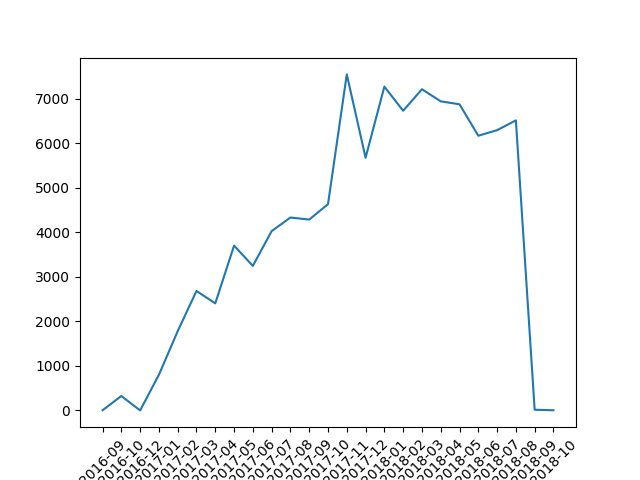
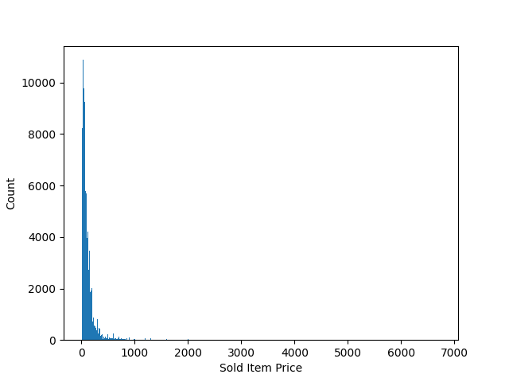
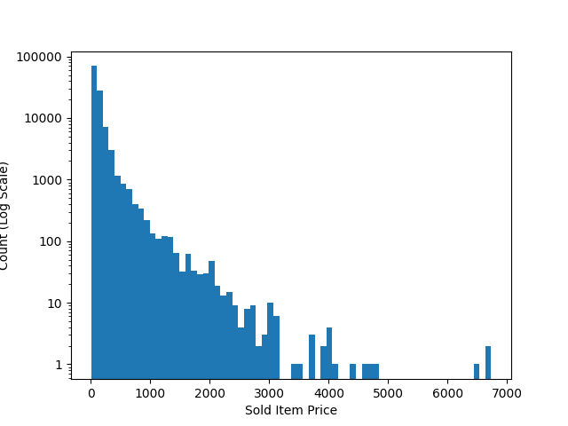

## Row Counts by Dataset

| Dataset                               |   Row Count |
|:--------------------------------------|------------:|
| olist_customers_dataset.csv           |       99441 |
| olist_orders_dataset.csv              |       99441 |
| olist_order_items_dataset.csv         |      112650 |
| olist_order_payments_dataset.csv      |      103886 |
| olist_order_reviews_dataset.csv       |       99224 |
| olist_products_dataset.csv            |       32951 |
| olist_sellers_dataset.csv             |        3095 |
| product_category_name_translation.csv |          71 |

## Columns with Missing Values in olist_orders_dataset.csv

| Column                        |   Null Count |   Null Counts Expressed as a Percentage |
|:------------------------------|-------------:|----------------------------------------:|
| order_approved_at             |          160 |                                    0.16 |
| order_delivered_carrier_date  |         1783 |                                    1.79 |
| order_delivered_customer_date |         2965 |                                    2.98 |

## Columns with Missing Values in olist_order_reviews_dataset.csv

| Column                 |   Null Count |   Null Counts Expressed as a Percentage |
|:-----------------------|-------------:|----------------------------------------:|
| review_comment_title   |        87656 |                                   88.34 |
| review_comment_message |        58247 |                                   58.70 |

## Columns with Missing Values in olist_products_dataset.csv

| Column                     |   Null Count |   Null Counts Expressed as a Percentage |
|:---------------------------|-------------:|----------------------------------------:|
| product_category_name      |          610 |                                    1.85 |
| product_name_lenght        |          610 |                                    1.85 |
| product_description_lenght |          610 |                                    1.85 |
| product_photos_qty         |          610 |                                    1.85 |
| product_weight_g           |            2 |                                    0.01 |
| product_length_cm          |            2 |                                    0.01 |
| product_height_cm          |            2 |                                    0.01 |
| product_width_cm           |            2 |                                    0.01 |

## Time Series of Orders

## customer_id in olist_orders_dataset.csv Not Present in olist_customers_dataset.csv

| customer_id   |
|---------------|

## order_id in olist_order_items_dataset.csv Not Present in olist_orders_dataset.csv

| order_id   |
|------------|

## product_id in olist_order_items_dataset.csv Not Present in olist_products_dataset.csv

| product_id   |
|--------------|

## seller_id in olist_order_items_dataset.csv Not Present in olist_sellers_dataset.csv

| seller_id   |
|-------------|

## order_id in olist_order_payments_dataset.csv Not Present in olist_orders_dataset.csv

| order_id   |
|------------|

## order_id in olist_order_reviews_dataset.csv Not Present in olist_orders_dataset.csv

| order_id   |
|------------|

## Count of Duplicate Rows in Each Dataset

| dataset                               |   duplicate_count |
|:--------------------------------------|------------------:|
| olist_customers_dataset.csv           |                 0 |
| olist_orders_dataset.csv              |                 0 |
| olist_order_items_dataset.csv         |                 0 |
| olist_order_payments_dataset.csv      |                 0 |
| olist_order_reviews_dataset.csv       |                 0 |
| olist_products_dataset.csv            |                 0 |
| olist_sellers_dataset.csv             |                 0 |
| product_category_name_translation.csv |                 0 |

## Histogram of Sold Item Prices

## Summary of Sold Item Prices

|   min |     max |   median |   average |
|------:|--------:|---------:|----------:|
|  0.85 | 6735.00 |    74.99 |    120.65 |

## Histogram of Sold Item Prices With Logged Y-Axis

